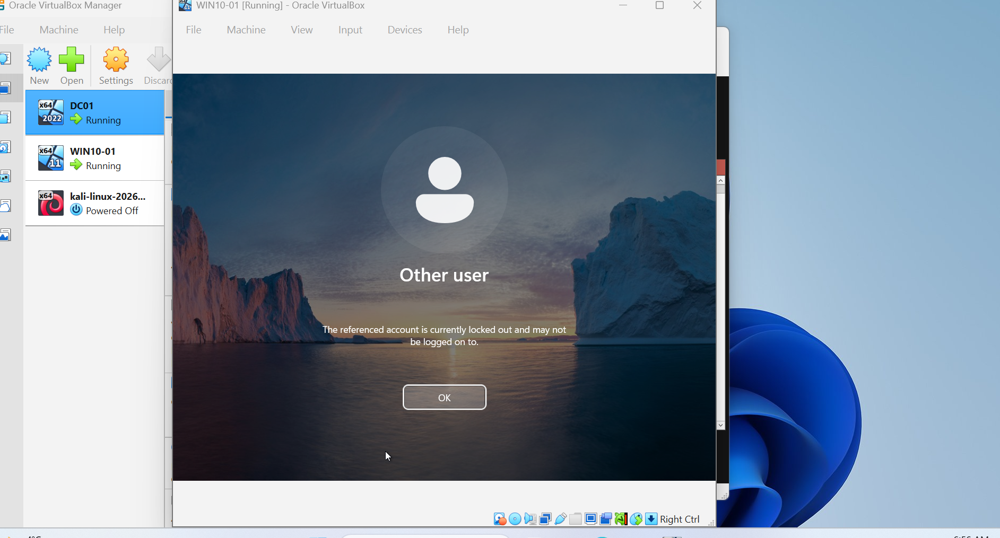
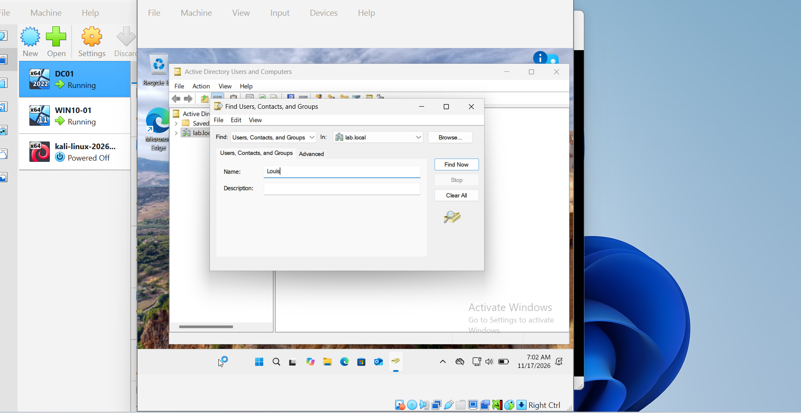
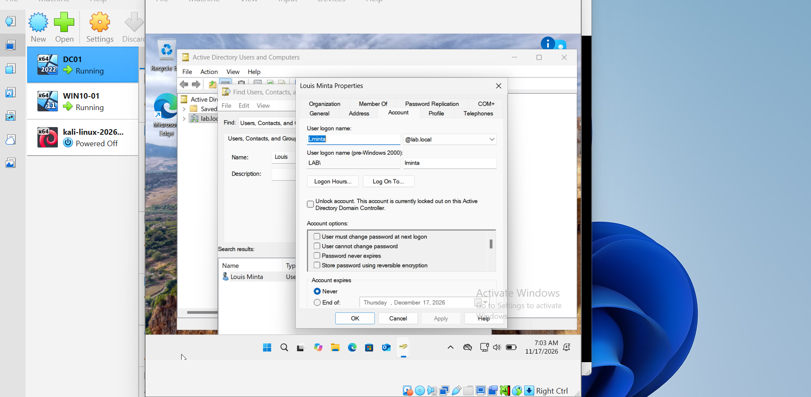
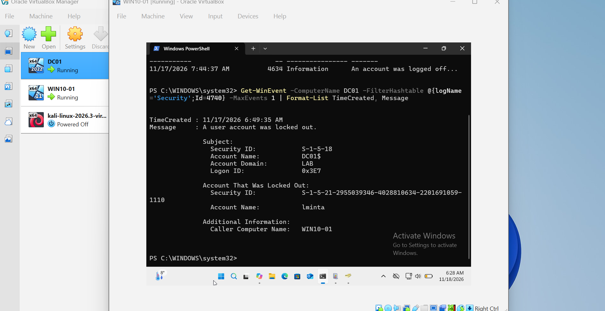
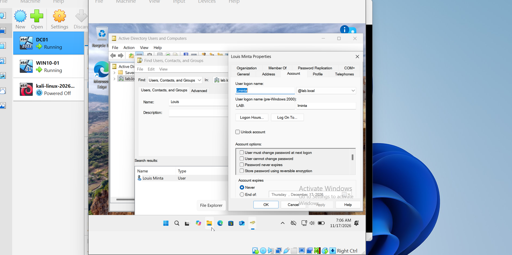
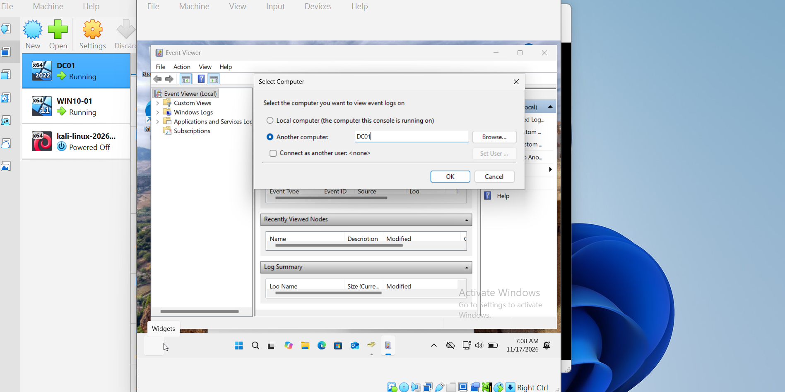

# Ticket #1: User Account Lockout

> **Issue:** Test user Louis Minta can't sign in. Windows reports the account is locked out.
>
> **Root cause:** Five failed sign-ins from his own workstation tripped the lockout policy.
>
> **Resolution:** Traced the source via event ID 4740, unlocked the account in ADUC, and confirmed a successful sign-in. No password reset was needed.

| Ticket | Date | Priority | Status |
| --- | --- | --- | --- |
| INC-0001 | Nov 14, 2026 | P4 – Low (single user) | Resolved |



## Lab setup

The domain's default lockout threshold was **0**, so accounts could never lock. I created a **Fine-Grained Password Policy** (`Lockout-Policy`) that locks an account for 15 minutes after 5 failed attempts, then triggered a lockout to create the ticket.

During review I found the policy had been created with **reversible encryption enabled**, which stores passwords in a recoverable form. I disabled it.

## Troubleshooting

**1. Verify the caller.** Confirm the user's identity before any account change. Help desks are a common social-engineering target.

**2. Confirm the lockout.** In Active Directory Users and Computers (ADUC), I searched for the user. The Account tab confirmed the lockout.





**3. Identify the source.** Domain controllers log every lockout as **event ID 4740**, including the computer the failed attempts came from. I queried DC01 remotely from the workstation:

```powershell
Get-WinEvent -ComputerName DC01 -FilterHashtable @{LogName='Security';Id=4740} -MaxEvents 1 |
  Format-List TimeCreated, Message
```

**Caller Computer Name: WIN10-01**, the user's own machine. Mistyped passwords, not an attack. No escalation needed.



**4. Resolve.** Ticked **Unlock account** in ADUC (`Unlock-ADAccount lminta` in PowerShell).



**5. Verify.** The user signed in successfully.

## Issues encountered

| Issue | Cause | Fix |
| --- | --- | --- |
| "The server has rejected the client credentials" | Signed in with a local account the domain doesn't trust | Used the domain account |
| Security log: "Access is denied" | Account was in Builtin\Administrators (DC-only), not Domain Admins | Added to Domain Admins and signed in again. Production help desks would use delegated rights instead. |
| Event Viewer wouldn't connect to DC01 | Remote event log access blocked by the firewall | Enabled the "Remote Event Log Management" rules. Event Viewer still failed, so I used `Get-WinEvent` instead. |



## Key takeaways

- **Unlock ≠ reset.** If the user knows the password, an unlock is enough.
- **Always check the lockout source.** An unfamiliar device, or several accounts locking at once, can point to brute-force or password-spray activity. Escalate to security.
- **Lockouts expire.** After the lockout duration (15 minutes here), the account unlocks itself.
- **Repeat lockouts** usually come from an old password saved on a phone or another device.

**Skills:** Active Directory Users and Computers · Fine-Grained Password Policy · Windows Security event log · PowerShell (AD module) · permissions troubleshooting · escalation judgment
