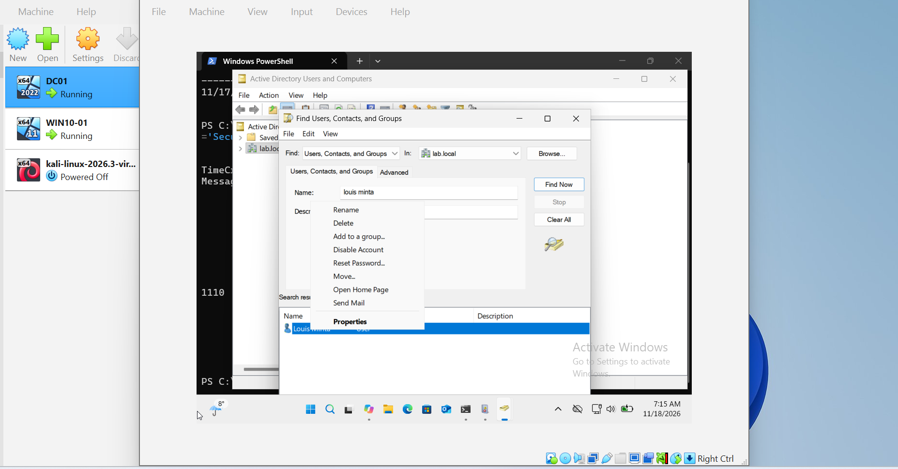
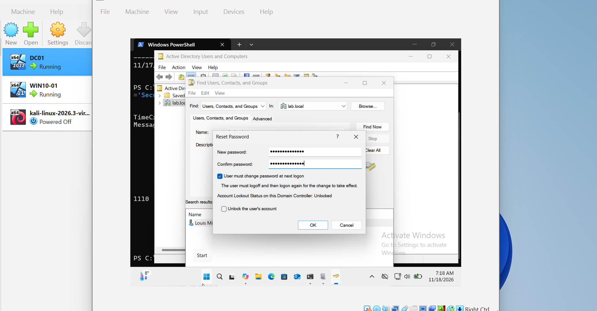
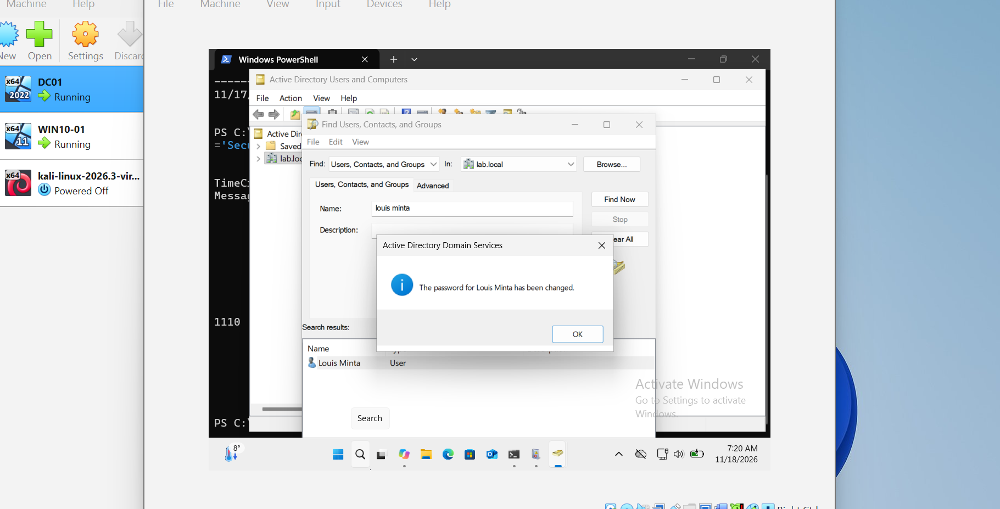
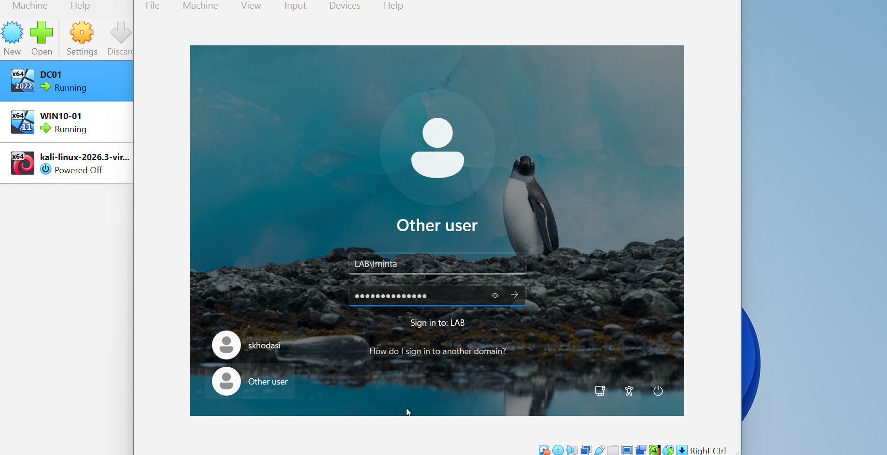
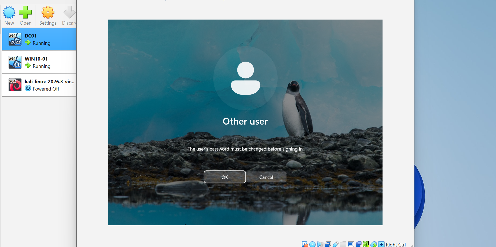
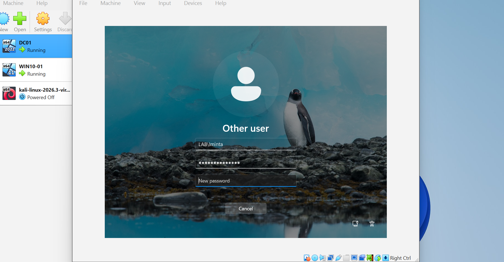
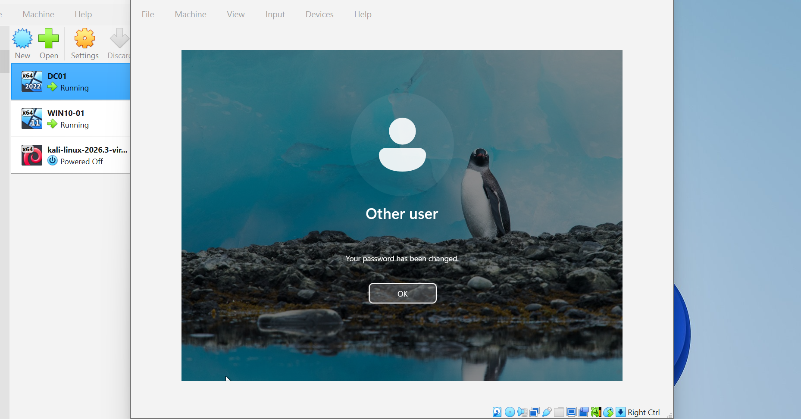
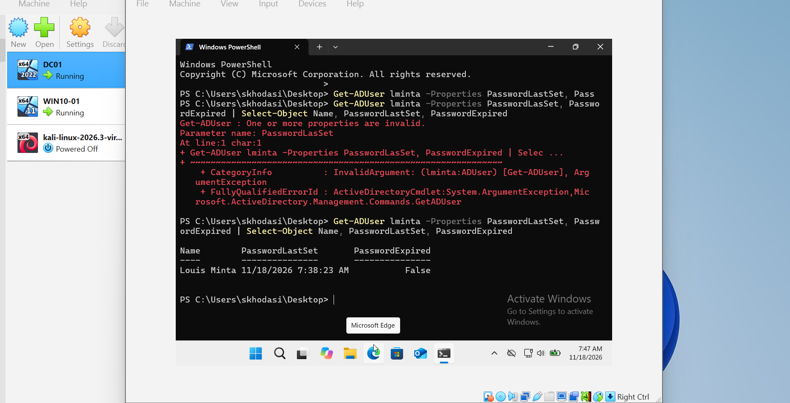

# Ticket #2: Password Reset

> **Issue:** Test user Louis Minta forgot his password after time off.
>
> **Resolution:** Reset the password in ADUC to a temporary value with **"User must change password at next logon"** enabled. He set his own password at first sign-in, so IT never knows the working credential.

| Ticket | Date | Priority | Status |
| --- | --- | --- | --- |
| INC-0002 | Nov 18, 2026 | P4 – Low (single user) | Resolved |

## Unlock vs. reset

In [Ticket #1](../ticket-01-account-lockout/) the user still knew his password, so an unlock was enough. Here the password was forgotten, so a **reset** was needed. The Reset Password dialog confirmed the account wasn't locked, so no unlock was required alongside it.

## Resolution

**1. Verify the caller.** A reset for an impostor hands them the account, so this is the most important step.

**2. Locate the user.** In ADUC, I searched for the user and right-clicked. That menu covers most daily account tasks: reset, disable, add to group, move.



**3. Reset with a forced change.** I set a policy-compliant temporary password (8+ characters, mixed case, number, symbol) and left **User must change password at next logon** enabled.





PowerShell equivalent:

```powershell
Set-ADAccountPassword lminta -Reset -NewPassword (Read-Host -AsSecureString "Temp password")
Set-ADUser lminta -ChangePasswordAtLogon $true
```

**4. Deliver the password securely.** Verbally, or through an approved secure channel. Never in plain email or in ticket notes.

## Verification

**User side:** signed in with the temporary password, was prompted to set a new one, and reached the desktop.









**Admin side:**

```powershell
Get-ADUser lminta -Properties PasswordLastSet, PasswordExpired |
  Select-Object Name, PasswordLastSet, PasswordExpired
```

`PasswordLastSet` matches the moment the user chose his own password, and `PasswordExpired` is **False**, so the forced change is complete.



## Key takeaways

- **The help desk should never know a user's working password.** Always force a change at next sign-in.
- **Coach on the new password.** A near-copy of the temporary password is easy to guess, and password history doesn't block it.
- **Never record passwords** in tickets or email.
- **Treat repeated reset requests, or callers who fail verification, as possible social engineering.**

**Skills:** Active Directory Users and Computers · password and complexity policy · secure credential handling · PowerShell (AD module) · two-sided verification
