# Ticket #3: New Hire Onboarding

> **Request:** HR needs an account for Kevin Hodasi (test user), a new Accounting Clerk reporting to Louis Minta.
>
> **Result:** Provisioned the user in a department OU with role-based group access, linked his manager, and applied the company lockout policy through group membership. First sign-in verified.

| Ticket | Date | Type | Status |
| --- | --- | --- | --- |
| REQ-0003 | Nov 18, 2026 | Service request – onboarding | Completed |

## Design: access through groups, not individuals

Permissions and policies are attached to **security groups**, and users are added to those groups. Onboarding, role changes and offboarding become simple membership changes. It's consistent, auditable, and nothing gets missed when someone leaves.

## Steps

**1. Create department OUs.** I created **Staff → Accounting** Organizational Units, with protection from accidental deletion enabled. OUs organise accounts by department and let Group Policy target a department later.

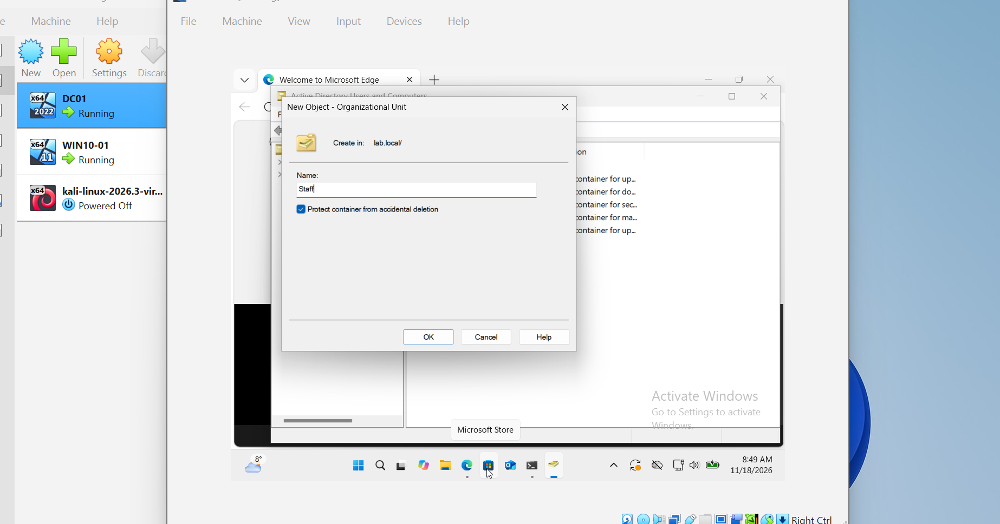

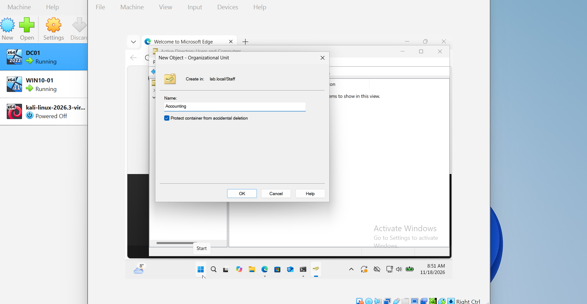

**2. Create security groups** (Global scope, Security type):

| Group | Purpose |
| --- | --- |
| **All Staff** | Every employee. Company-wide access and policies. Used instead of the built-in *Domain Users*, which also contains admin, service and test accounts. |
| **Accounting** | Department access, such as the Accounting file share (a later ticket). |

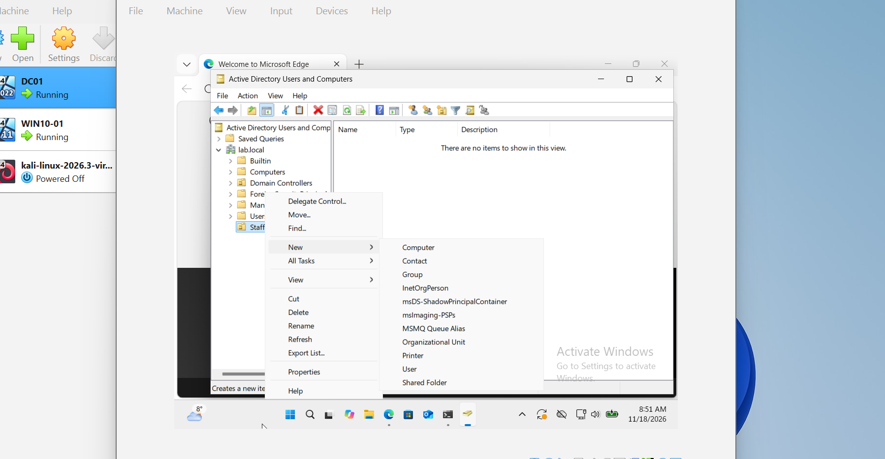

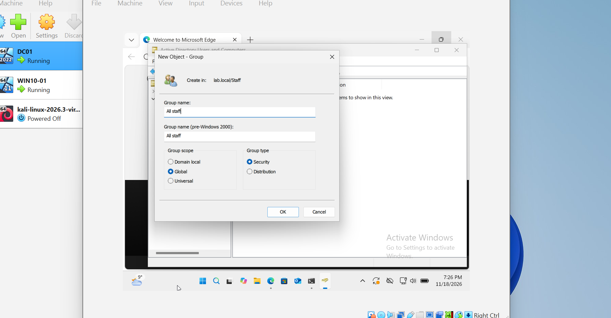

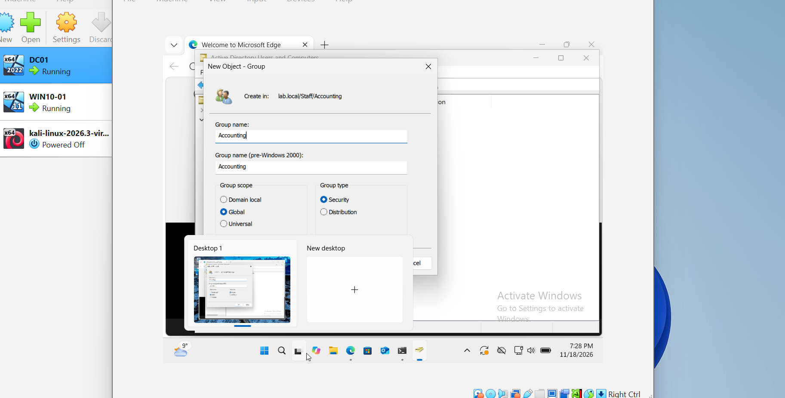

**3. Create the user account** in the Accounting OU (`khodasi@lab.local`), with a temporary password and **"User must change password at next logon"** enabled.

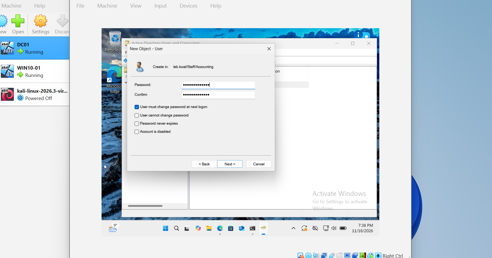

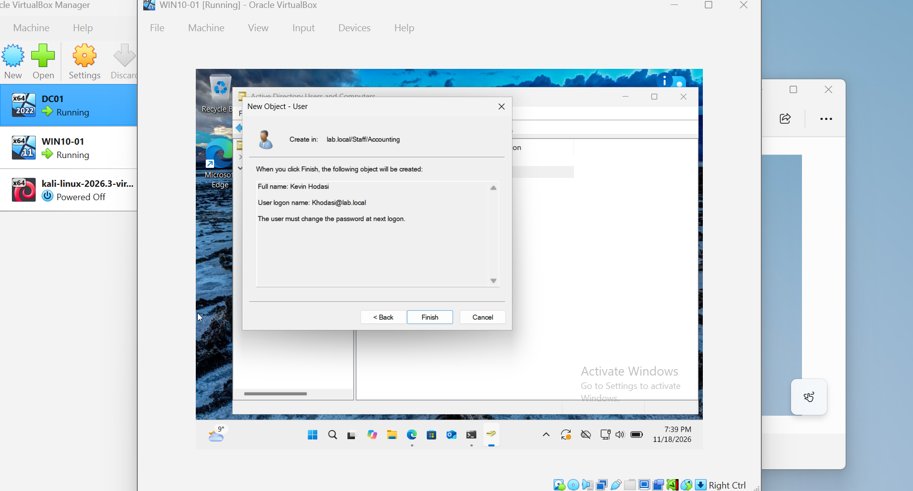

**4. Set profile attributes:** Job Title, Department and Manager. These feed the company directory and address book, and Kevin now appears under Louis's direct reports.

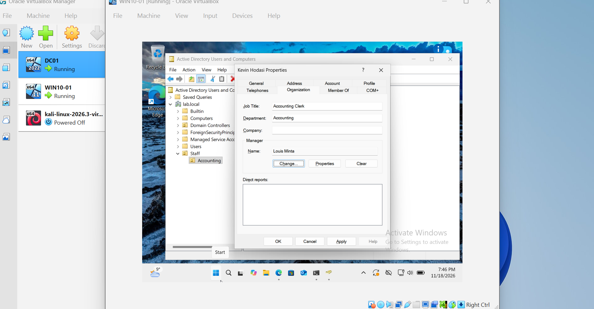

**5. Assign group memberships:** All Staff and Accounting.

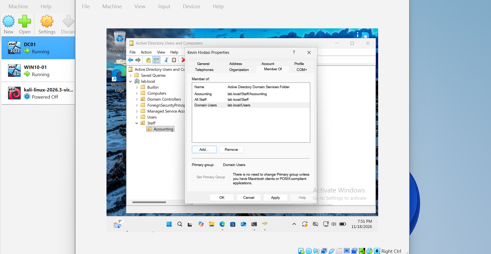

**6. Apply the lockout policy to All Staff.** In **Active Directory Administrative Center**, I added All Staff to `Lockout-Policy`'s *Directly Applies To* list. Before this, the policy covered only one user. Now every current and future member of All Staff gets it automatically.

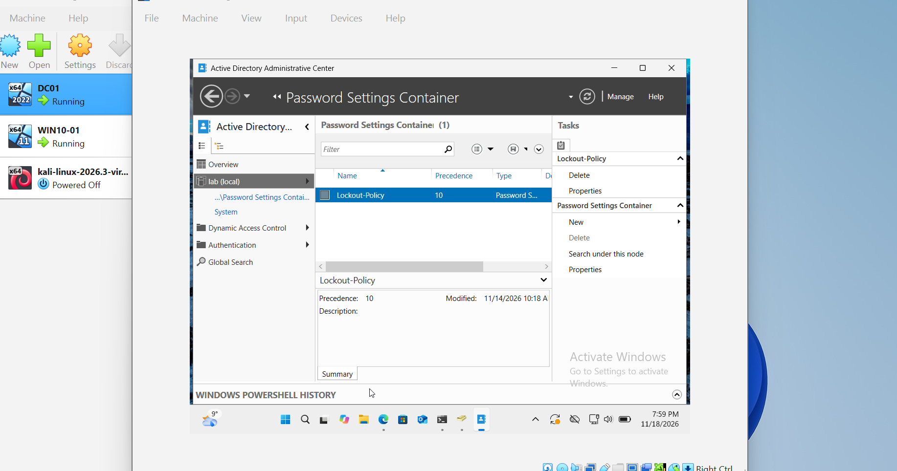

| Before | After |
| --- | --- |
| 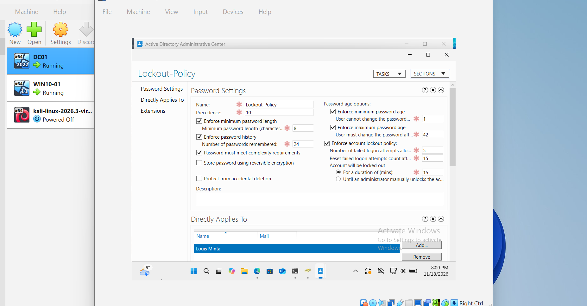 | 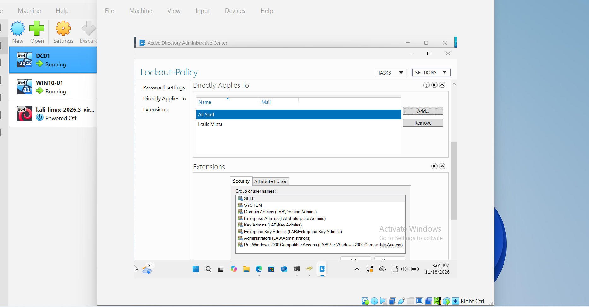 |

```powershell
Add-ADFineGrainedPasswordPolicySubject -Identity "Lockout-Policy" -Subjects "All Staff"
```

## Verification

**Policy applies through the group.** The resultant policy for Kevin shows `Lockout-Policy`, with *AppliesTo* listing All Staff, not Kevin by name. That confirms inheritance through membership.

```powershell
Get-ADUserResultantPasswordPolicy khodasi
```

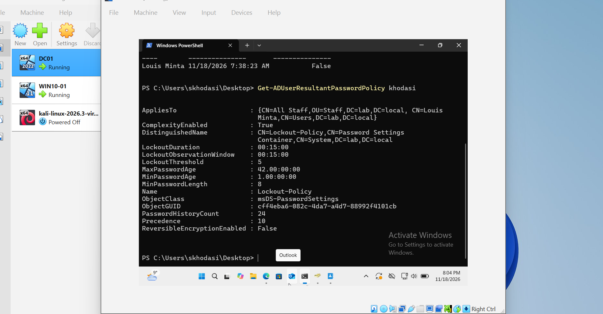

**First sign-in.** Kevin signed in with the temporary password, was required to set his own, and reached the desktop.

**Group token at sign-in.** From Kevin's session:

```powershell
whoami /groups | findstr LAB
```

Both `LAB\All Staff` and `LAB\Accounting` appear. Group memberships load at sign-in, which is why the account was fully configured before first login.

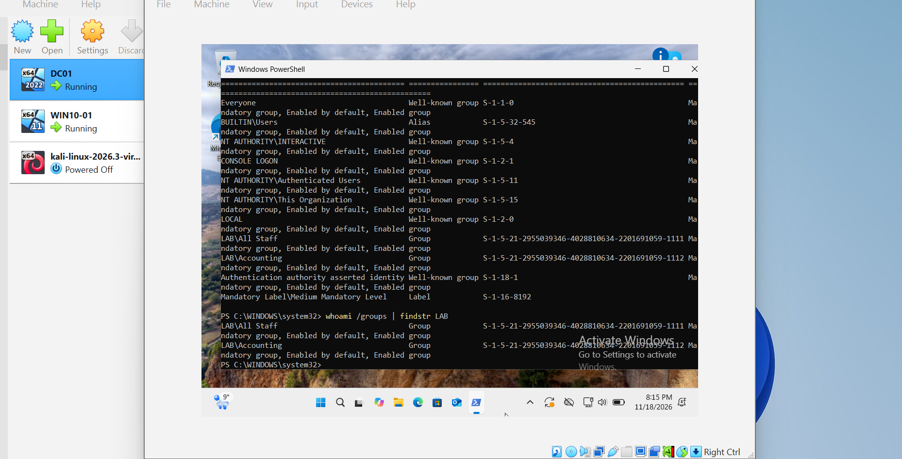

## Key takeaways

- **Role-based access through groups** makes offboarding a membership change, not a hunt for permissions.
- **Least privilege:** the user received only the groups the role requires.
- **Naming conventions matter.** `khodasi` and the admin account `skhodasi` differ by one letter. Always confirm the full name before modifying an account.
- **Follow-up:** move Louis Minta into All Staff and remove his direct policy link, so one rule covers everyone.

**Skills:** Active Directory Users and Computers · Active Directory Administrative Center · OU design · security groups (scope and type) · user provisioning · Fine-Grained Password Policy · PowerShell verification · least privilege
