# Ticket #5: Shared Folder Access Denied

> **Issue:** Louis Minta (test user, Accounting manager) gets "You do not have permission to access \\\\DC01\\Accounting" and needs the month-end files.
>
> **Root cause:** Access to the share is granted only to the **Accounting** security group, and Louis was never added to it.
>
> **Resolution:** With the folder owner's approval, added Louis to Accounting (and All Staff). After he signed out and back in, he opened the share and created a file.

| Ticket | Date | Priority | Status |
| --- | --- | --- | --- |
| INC-0005 | Nov 21, 2026 | P3 – Medium (blocked from month-end work) | Resolved |

## How shared folder access works

A network share has **two layers of permissions**, and a user must pass both. The stricter of the two wins.

| Layer | Where it's set | Controls |
| --- | --- | --- |
| **Share permissions** | Sharing settings / `New-SmbShare` | Who can reach the folder **over the network** |
| **NTFS permissions** | Folder Properties → Security tab | Who can open the files **on the disk** |

Most "access denied" calls come down to one of these layers, or to the user not being in the right group.

## Setup: build the Accounting share

> In production, file shares live on a dedicated file server, never on a domain controller. This lab has one server, so the share is on DC01.

**1. Create the folder** on DC01:

```powershell
New-Item -Path C:\Shares\Accounting -ItemType Directory
```

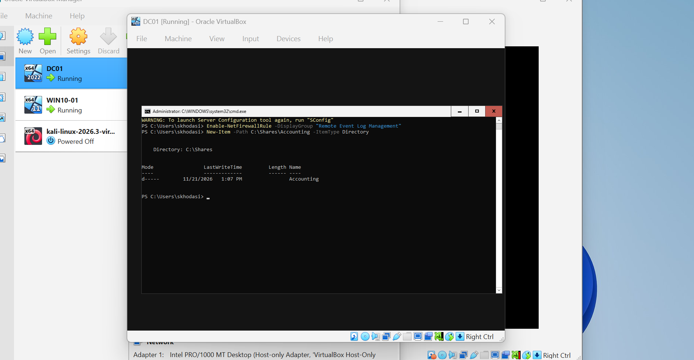

**2. Share it (layer 1).** Only Domain Admins (full) and the Accounting group (change) can reach it over the network:

```powershell
New-SmbShare -Name Accounting -Path C:\Shares\Accounting -FullAccess "LAB\Domain Admins" -ChangeAccess "LAB\Accounting"
```

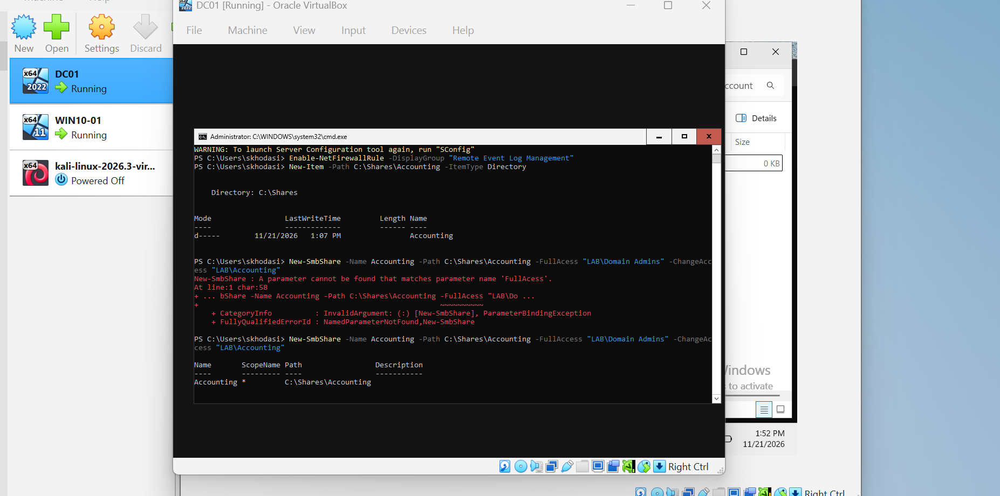

**3. Lock down NTFS permissions (layer 2).** From the help desk workstation I opened the server's admin share (`\\DC01\C$\Shares`), which is available to administrators only.

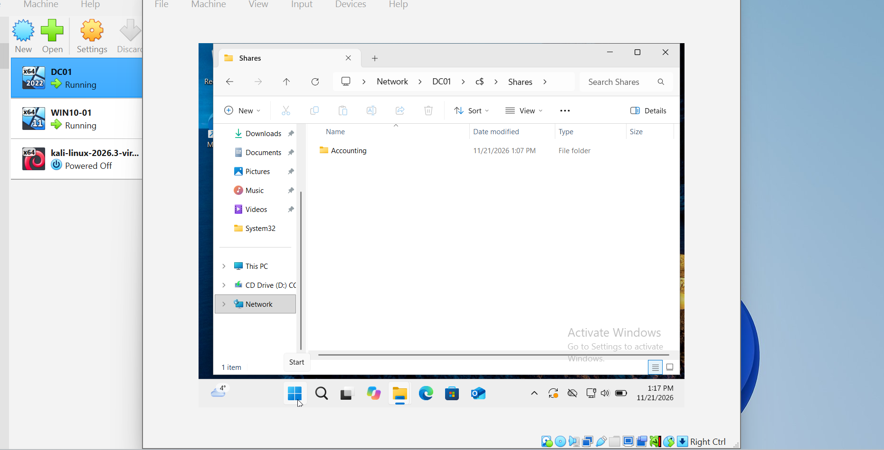

The folder had inherited **Users (LAB\Users)**, meaning every domain user, from the C: drive:

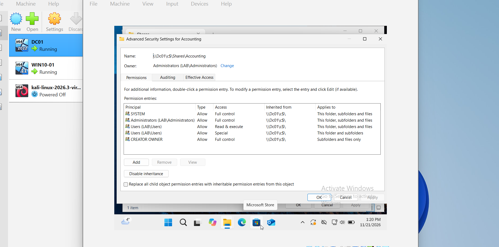

I disabled inheritance (converting entries to explicit), removed both **Users** entries, and granted **Accounting** the **Modify** permission. Modify lets staff create, edit and delete files. Full control would also let them change permissions, which stays with IT.

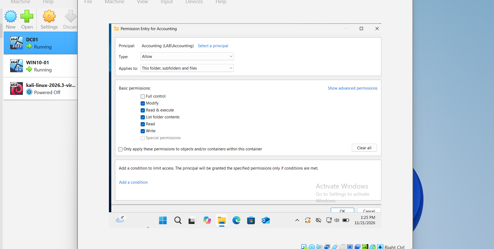

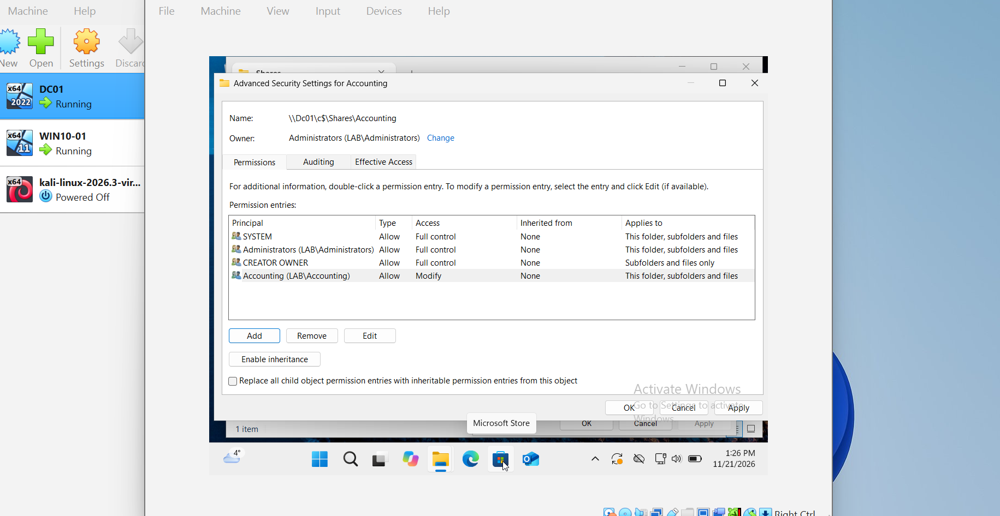

Both layers now restrict access independently (**defence in depth**), so neither depends on the other.

## Troubleshooting

**1. Reproduce the issue.** Signed in as Louis and opened `\\DC01\Accounting`:

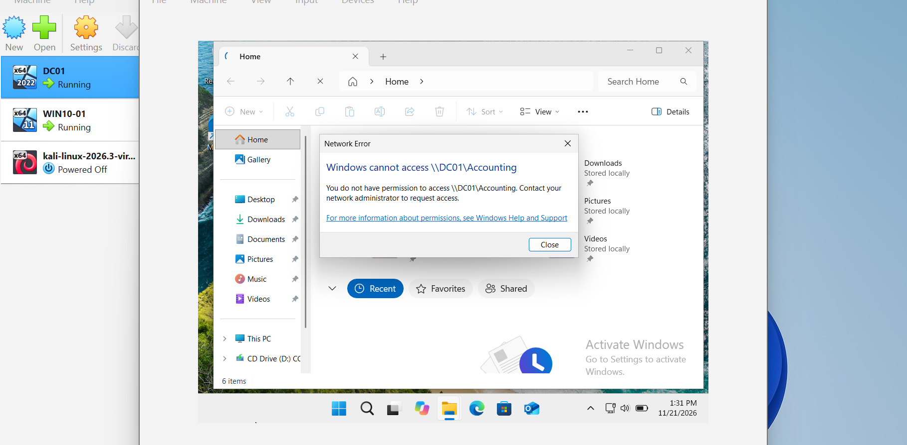

**2. Check the user's group membership.** Louis's access token (`whoami /groups`) showed no Accounting group. In Active Directory Users and Computers, his **Member Of** tab confirmed it: Domain Users only.

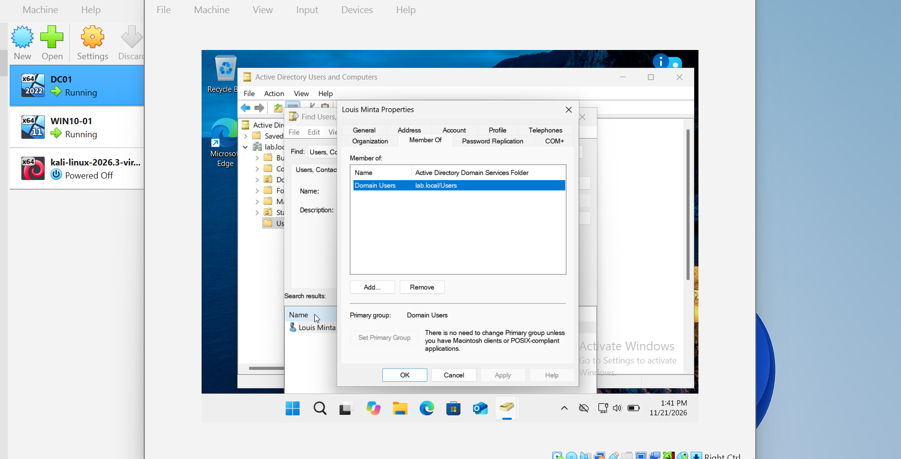

**3. Root cause:** both permission layers grant access to the Accounting group, and Louis isn't in it.

## Resolution

**1. Confirm approval.** Access to a department share is granted with the folder owner's approval, usually the department manager. Louis is the Accounting manager, so the request was valid.

**2. Add the user to the group.** Added Louis to **Accounting**. I also added him to **All Staff**, which he had been missing since onboarding, so company-wide access and the lockout policy reach him through the group like everyone else.

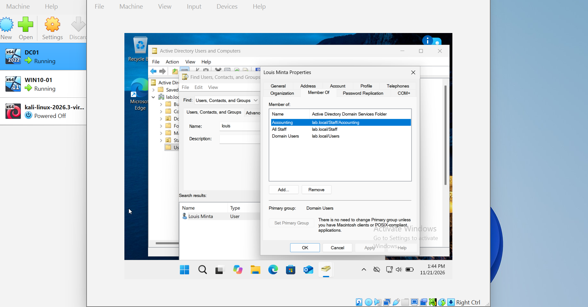

**3. Sign out and back in.** Group memberships load at sign-in, so the change only takes effect in a new session.

## Verification

Signed in as Louis, opened `\\DC01\Accounting`, and created a test file. That confirms both **read** and **write** access through both layers.

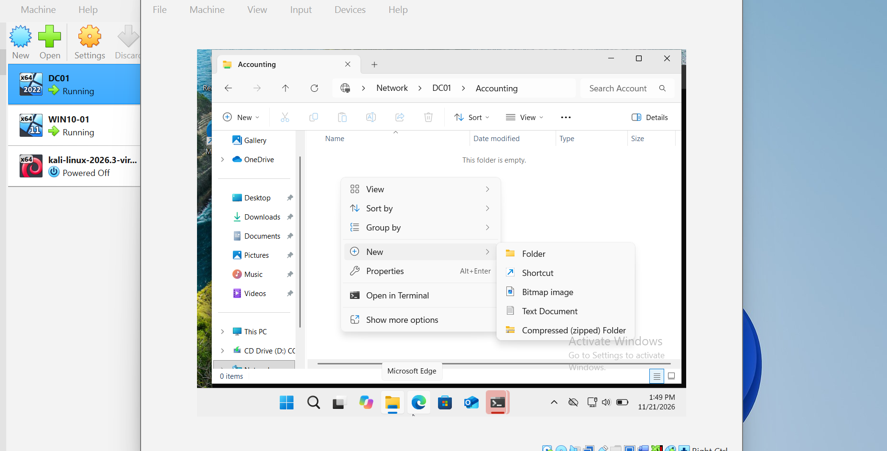

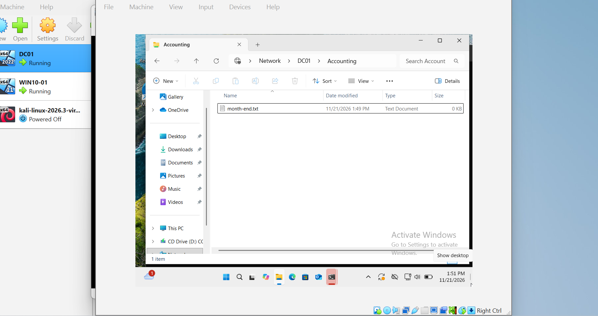

## Key takeaways

- **Share + NTFS = two locks.** Check both when troubleshooting, and remember the most restrictive one wins.
- **Fix the group, not the folder.** Adding the user to the right group is the correct fix. Granting the individual direct permissions creates access that's hard to track and easy to forget.
- **Get approval** before granting access to someone else's data.
- **"Sign out and back in"** is a genuine step after a group change, not a brush-off.
- **Least privilege:** Modify for staff, Full control only for IT.

**Skills:** SMB shares · NTFS permissions and inheritance · security groups · Active Directory Users and Computers · admin shares · access troubleshooting · least privilege · PowerShell
