# Ticket #6: Map the Accounting Drive with Group Policy

> **Request:** Louis Minta (test user, Accounting manager) wants the Accounting share to appear as a drive instead of typing `\\DC01\Accounting` every time.
>
> **Result:** Created a Group Policy Object that maps `\\DC01\Accounting` as **S:** for everyone in the Accounting OU. Verified the drive appeared at sign-in and confirmed the GPO applied with `gpresult`.
>
> **Also resolved:** a domain-wide "cannot contact a domain controller" fault caused by the domain controller registering an unreachable IP address in DNS.

| Ticket | Date | Type | Status |
| --- | --- | --- | --- |
| REQ-0006 | Nov 21, 2026 | Service request (+ incident found during work) | Completed |

## Why Group Policy instead of mapping by hand

Mapping the drive manually fixes one user on one computer. A **Group Policy Object (GPO)** is configured once and applies automatically at sign-in to every user in the targeted **OU**, on any computer, including future hires. That's how organisations deliver drive mappings at scale.

## Steps

**1. Move the user into the department OU.** GPOs link to Organizational Units, and the built-in *Users* container can't have a GPO linked to it. Louis was moved from *Users* to **Staff → Accounting**.

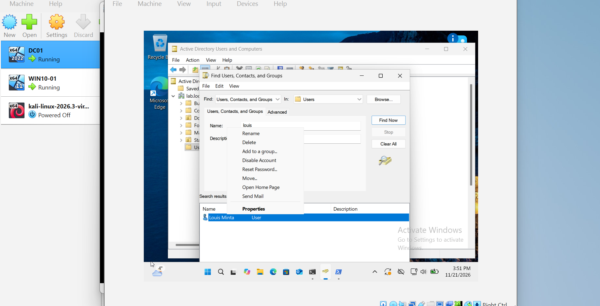

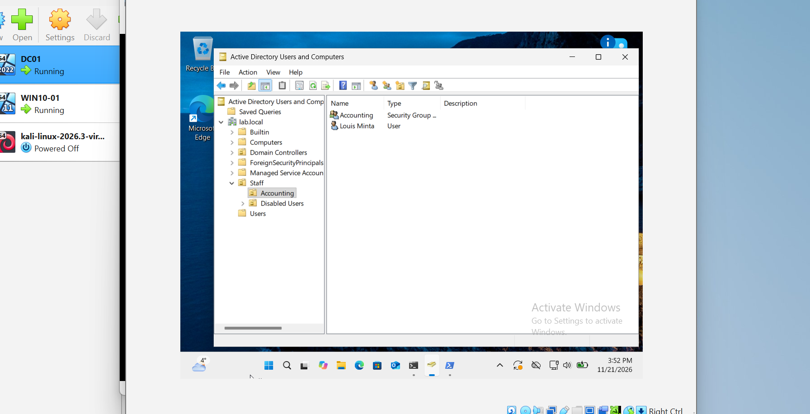

**2. Create and link the GPO.** In Group Policy Management: right-click the Accounting OU → **Create a GPO in this domain, and Link it here** → `Accounting - Map S Drive`. The descriptive name states who it targets and what it does.

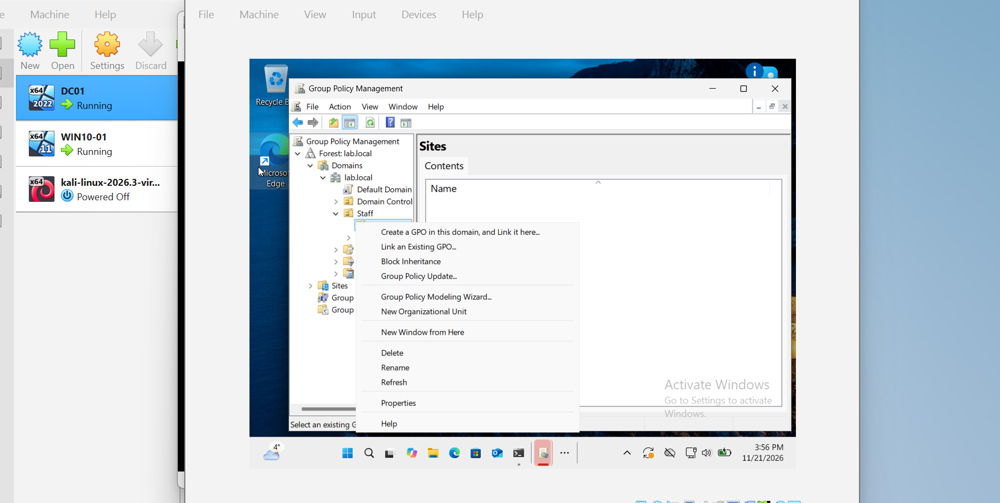

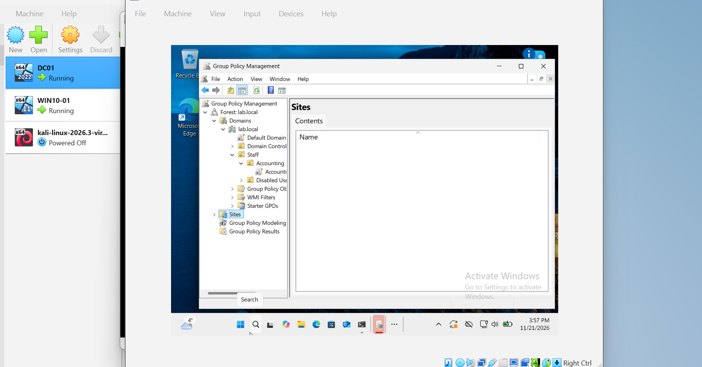

**3. Configure the drive mapping.** In the GPO editor: **User Configuration → Preferences → Windows Settings → Drive Maps → New → Mapped Drive**. It's a *user* setting, so the drive follows the person to any computer.

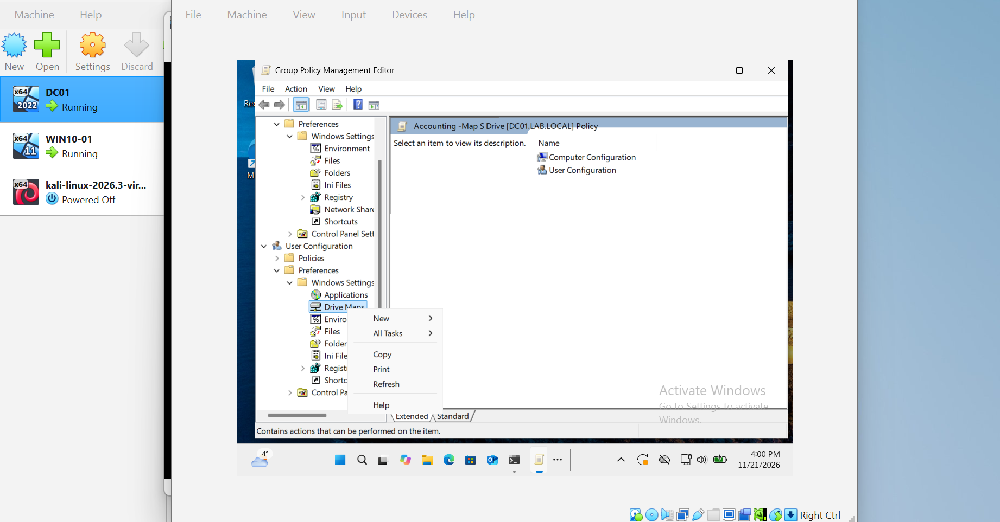

| Setting | Value | Why |
| --- | --- | --- |
| Action | Update | Creates the drive if missing, corrects it if wrong |
| Location | `\\DC01\Accounting` | The share from [Ticket #5](../ticket-05-shared-folder-access/) |
| Reconnect | On | Persists across sign-ins |
| Label | Accounting | Friendly name in File Explorer |
| Drive letter | S: | Consistent letter for every Accounting user |

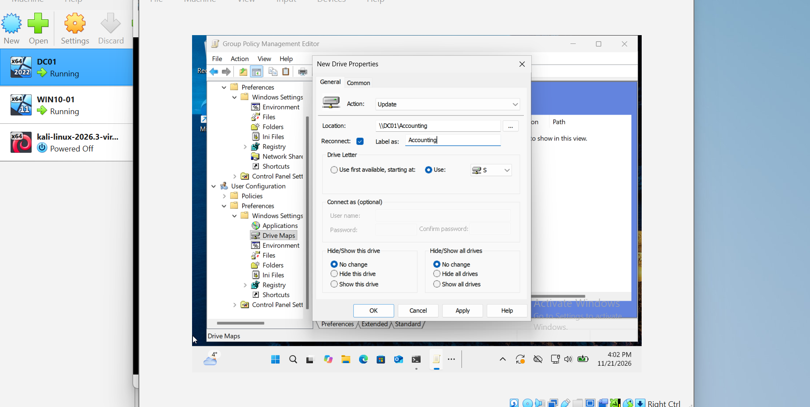

## Verification

**Policy refresh.** Signed in as Louis and ran `gpupdate /force` to apply the latest policy immediately.

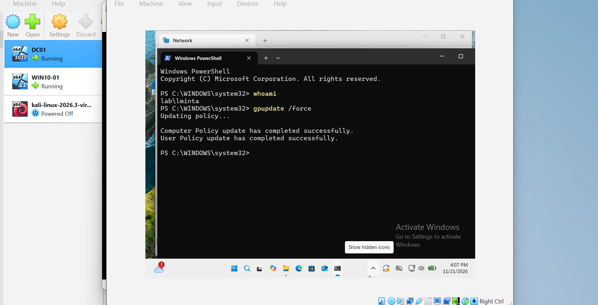

**Drive appears.** **Accounting (S:)** shows under This PC and opens the share, including `month-end.txt` from Ticket #5.

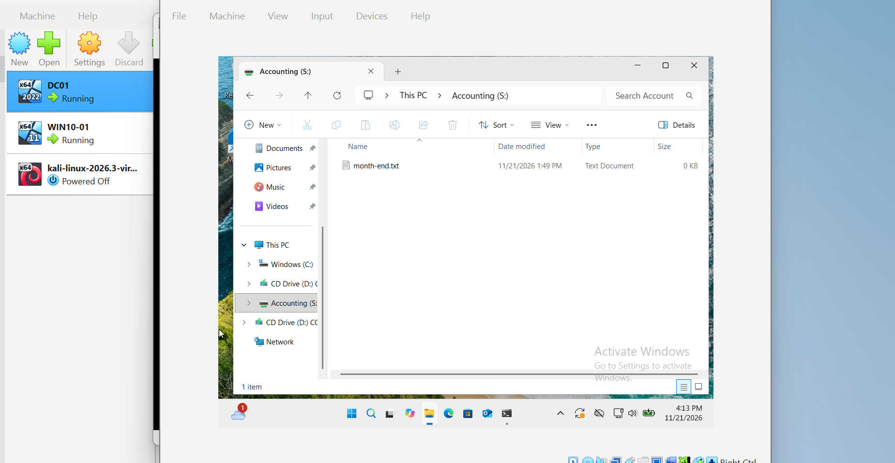

**Policy confirmed.** `gpresult /r /scope user` lists **Accounting - Map S Drive** under *Applied Group Policy Objects*, applied from `DC01.lab.local` to `OU=Accounting,OU=Staff`.

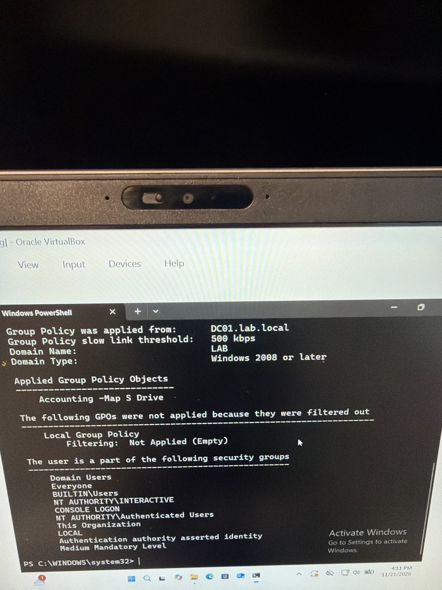

## Issue encountered: "cannot contact a domain controller"

While starting this ticket, Active Directory Users and Computers failed with *"Naming information cannot be located... The system cannot contact a domain controller."*

| Check | Result | Meaning |
| --- | --- | --- |
| `Test-Connection DC01` | Replies from 192.168.56.102 | Network path is fine |
| `nltest /dsgetdc:lab.local` | `ERROR_NO_SUCH_DOMAIN` | Client can't locate a domain controller |
| `klist` | 0 tickets | Signed in on cached credentials |
| DNS client settings | NAT adapter pointed at the home router | Domain lookups could leave the lab |
| DC services (DNS, Netlogon, NTDS) | All running | Active Directory itself was healthy |
| DC locator SRV record | Present | DC advertised correctly... |
| `dc01` A records | **192.168.56.102 and 10.0.3.15** | ...but also advertised its NAT address |

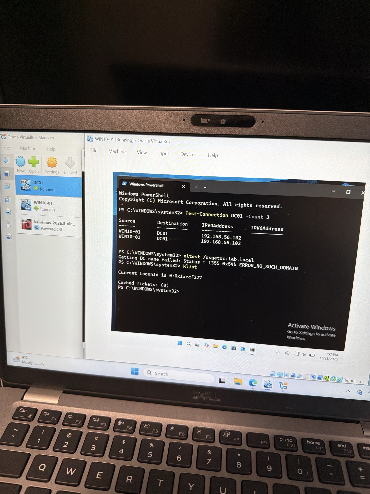

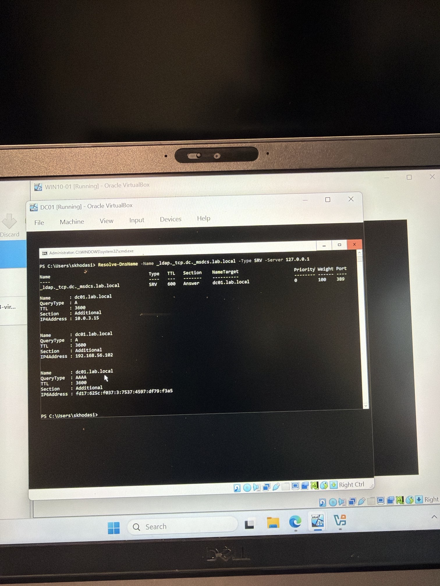

**Root cause:** a **multi-homed domain controller**. DC01's second (NAT) adapter registered `10.0.3.15` in DNS. That address is unreachable from clients, and in VirtualBox it's the same as the workstation's own NAT address. Because DNS returns both records and results are cached for 20 minutes, the failure was **intermittent**, depending on which address a client tried first.

**Fix:**

```powershell
# On DC01: stop the NAT adapter registering in DNS, and point it at itself for DNS
Set-DnsClient -InterfaceIndex 6 -RegisterThisConnectionsAddress $false
Set-DnsClientServerAddress -InterfaceAlias "Ethernet 2" -ServerAddresses 127.0.0.1

# On WIN10-01: domain clients should only use the domain's DNS
Set-DnsClientServerAddress -InterfaceIndex 6 -ServerAddresses 192.168.56.102
```

The bad record was removed, leaving only `192.168.56.102`, and the client located the domain controller again.

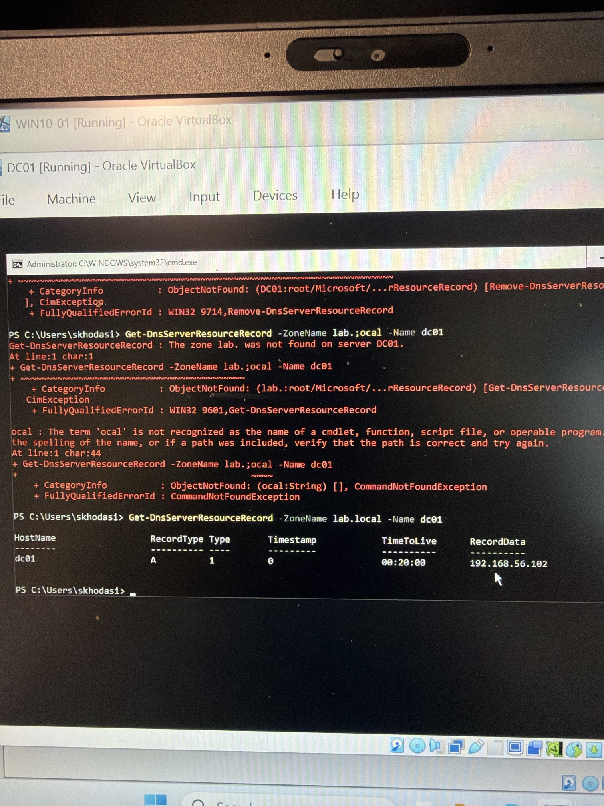

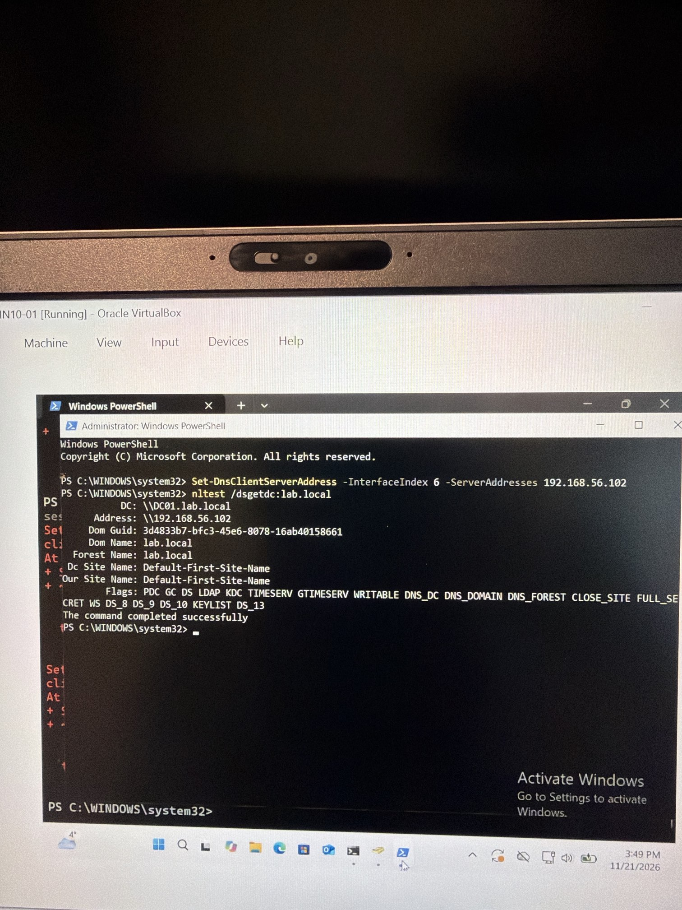

## Key takeaways

- **GPOs link to OUs, not the default Users container.** Users must be in the right OU for department policies to reach them.
- **Group Policy applies at sign-in.** `gpupdate /force` and a fresh sign-in apply changes. `gpresult` proves which GPOs applied.
- **"It's always DNS."** Active Directory depends on DNS to find domain controllers. A working ping doesn't mean domain lookups work.
- **Multi-homed domain controllers** should only register their production address in DNS.
- **Intermittent failures** often point to multiple DNS answers or cached results.

**Skills:** Group Policy Management · GPO Preferences (Drive Maps) · OU design · `gpupdate` / `gpresult` · DNS troubleshooting · `nltest` · Kerberos (`klist`) · PowerShell (DnsClient, DnsServer)
