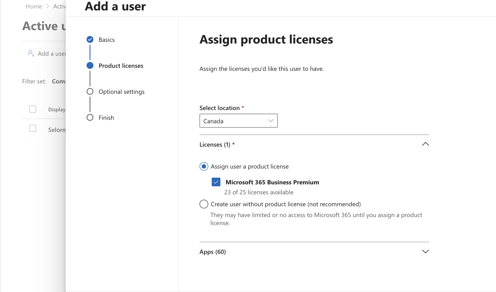
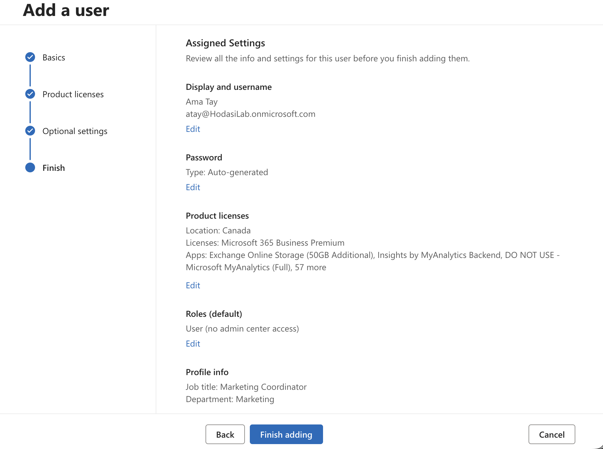
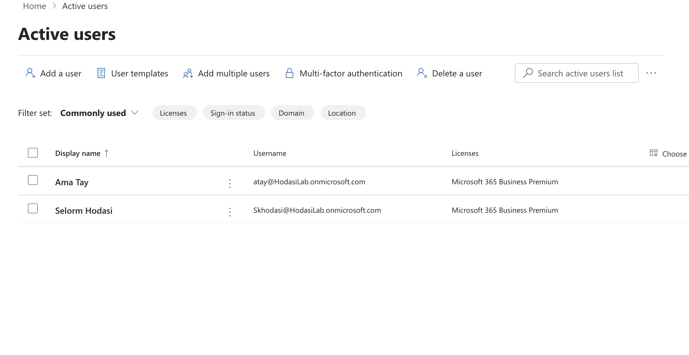
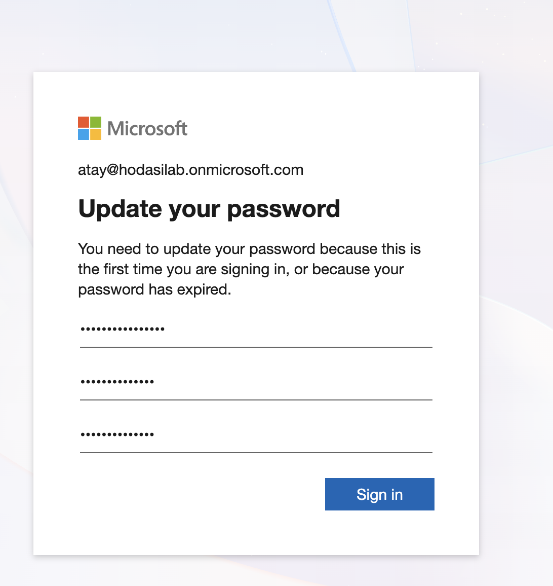
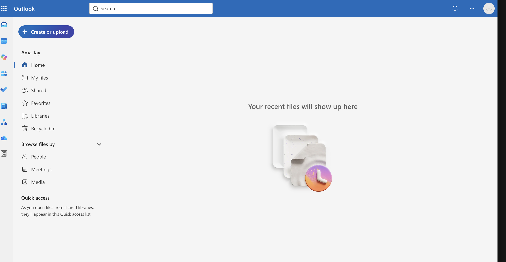

# Ticket #7: Create a Microsoft 365 Account for a New Hire

> **Request:** Marketing has a new Marketing Coordinator, Ama Tay (test user), starting this week. She needs a Microsoft 365 account with email and Office apps.
>
> **Result:** Created a cloud user in the Microsoft 365 admin center with a Business Premium licence, least-privilege role and a one-time password. Then signed in as the user to confirm the forced password change and that her mailbox and apps work.

| Ticket | Date | Type | Status |
| --- | --- | --- | --- |
| REQ-0007 | Nov 24, 2026 | Service request | Completed |

## Cloud vs on-premises accounts

[Ticket #3](../ticket-03-new-hire-onboarding/) onboarded a user into on-premises **Active Directory**, which controls sign-in to company computers and file shares. This ticket creates a **Microsoft Entra ID** (cloud) account in a Microsoft 365 tenant, which controls access to Outlook, Teams, OneDrive and the Office apps. Most organisations run both, so help desk staff work in both.

## Steps

**1. Basics.** In the Microsoft 365 admin center: **Users → Active users → Add a user**.

| Setting | Value | Why |
| --- | --- | --- |
| Display name | Ama Tay | Name shown in the address book |
| Username | `atay@HodasiLab.onmicrosoft.com` | Follows the first initial + surname convention |
| Password | Auto-generated | IT never chooses or knows the user's long-term password |
| Require password change at first sign-in | On | Only the user knows her real password |

**2. Licence.** Assigned **Microsoft 365 Business Premium** with the usage location set to **Canada**. Microsoft won't assign a licence without a usage location, and the licence is what creates the mailbox and unlocks the apps.

**3. Role and profile.** Kept the default **User (no admin center access)** role, which follows **least privilege**. Added the job title and department so she appears correctly in the company directory.

**4. Temporary password.** Microsoft shows the auto-generated password once. In a real handover it goes to the manager through a secure channel, never by email to the new mailbox, and never in documentation or screenshots.

## Verification

**Licence assigned.** Straight after creation, the Active users list showed Ama as *Unlicensed*. Microsoft 365 applies changes in the background, so the list can lag behind. After a refresh it showed **Microsoft 365 Business Premium**, confirming the licence had applied.

**First sign-in.** Signed in as Ama in a private browser window. Microsoft required her to replace the temporary password before continuing.

**Apps working.** Outlook opened with her new mailbox, and her OneDrive file area loaded. The account is ready for her first day.

## Issue encountered

| Symptom | Cause | Resolution |
| --- | --- | --- |
| New user showed *Unlicensed* despite the confirmation screen listing Business Premium | Normal sync delay in the admin center | Refreshed and re-checked before telling the requester the account was ready |

## Key takeaways

- **Verify, don't assume.** A success message isn't proof. Check the licence and sign in as the user before closing the ticket.
- **A licence needs a usage location**, and it's what creates the mailbox.
- **Auto-generated password + forced change** means IT never holds the user's real password.
- **Least privilege by default:** new users get no admin roles.

**Skills:** Microsoft 365 admin center · Microsoft Entra ID user management · licence assignment · least privilege · user onboarding verification
