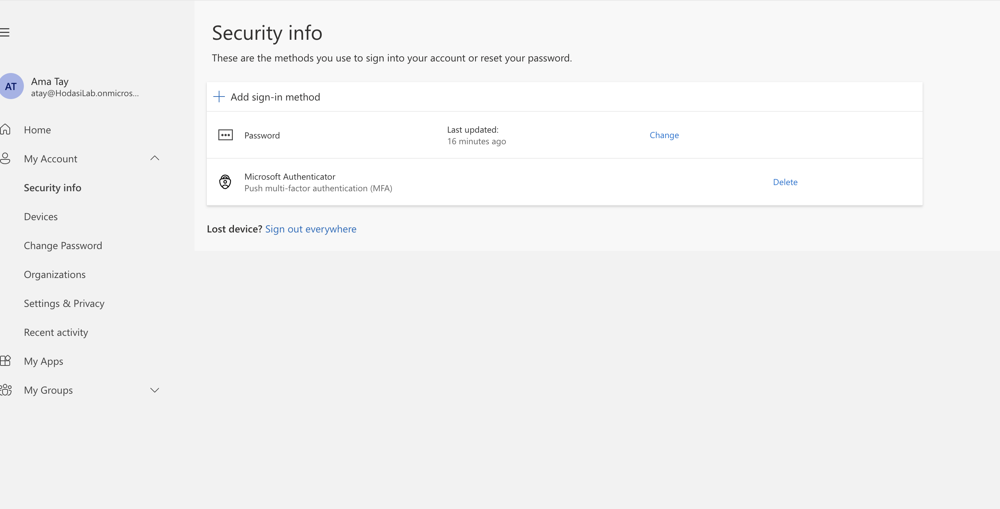
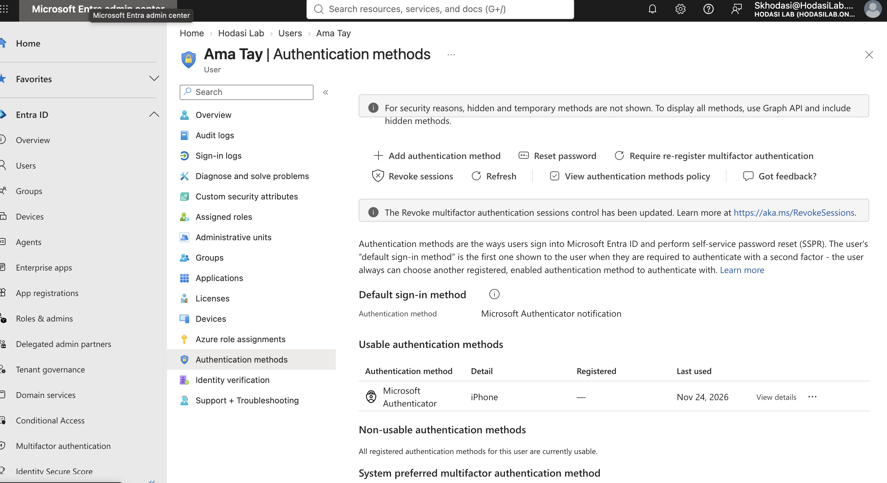
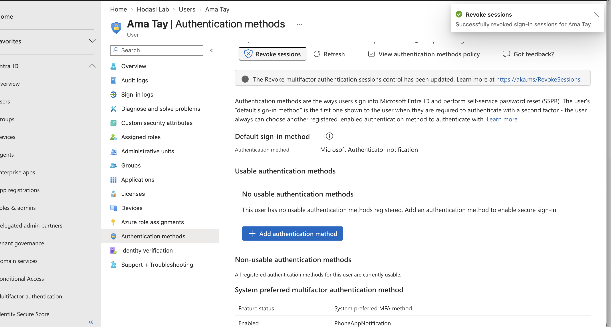
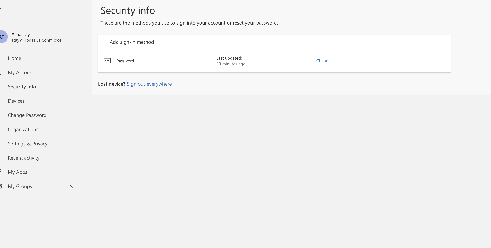
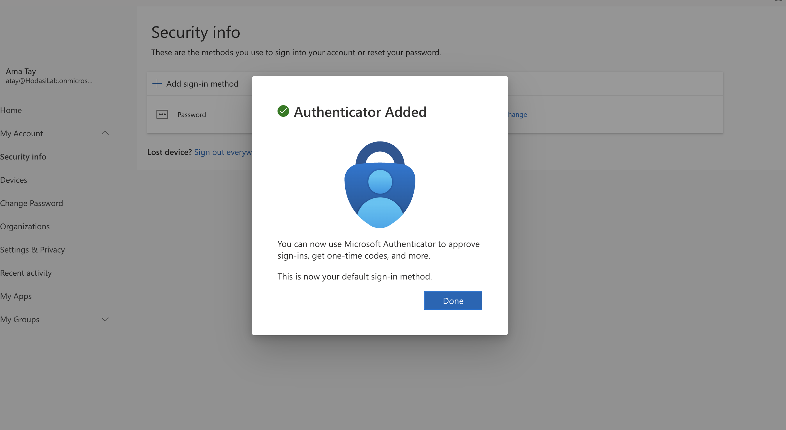
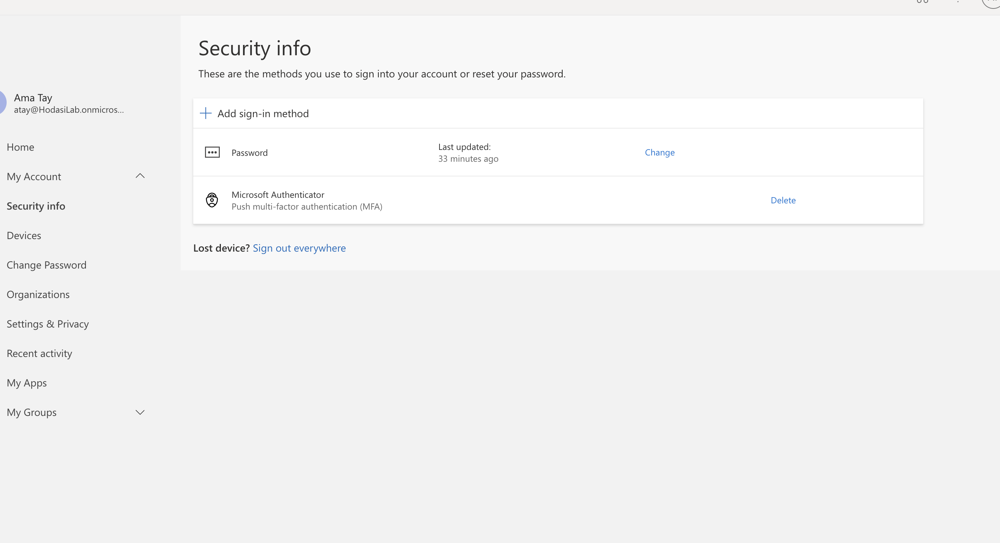
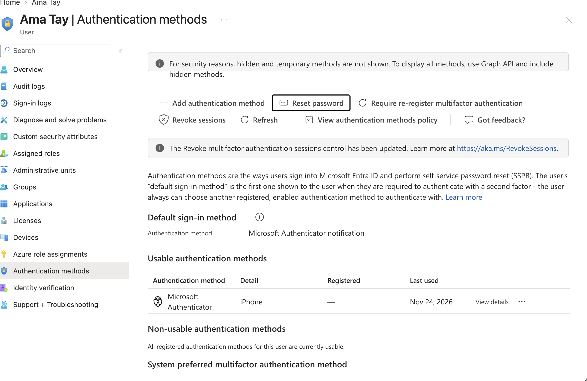

# Ticket #8: Reset MFA After a Lost Phone

> **Issue:** Ama Tay (test user, Marketing) got a new phone and Microsoft Authenticator didn't transfer. Every sign-in sends an approval request to her old iPhone, which she no longer has.
>
> **Root cause:** Her only MFA method was tied to the old phone.
>
> **Resolution:** Verified the caller, deleted the old phone's Authenticator registration, revoked her sign-in sessions, and guided her through registering Authenticator on the new phone. Confirmed the new method from the admin side.

| Ticket | Date | Priority | Status |
| --- | --- | --- | --- |
| INC-0008 | Nov 24, 2026 | P3 (single user, blocked from work) | Resolved |

## What MFA is

**Multi-factor authentication (MFA)** means a password alone isn't enough to sign in. The user also approves a notification in the **Microsoft Authenticator** app on their phone. That protects the account if the password is stolen, but if the phone is lost, the user is locked out too. "New phone, can't sign in" is one of the most common help desk calls.

## Steps

**0. Starting state.** Ama's account had Microsoft Authenticator registered on her iPhone, as she sees it on her **Security info** page.

**1. Verify the caller's identity.** Resetting MFA removes a security barrier. If the caller isn't really Ama, the reset hands an attacker her account. Before making any change, the help desk confirms identity through an approved method, such as a call back to the number on file or confirmation from her manager. *(Simulated in this lab.)*

**2. Review her MFA methods.** In the **Microsoft Entra admin center: Users → Ama Tay → Authentication methods**. The registered Authenticator showed **iPhone**, matching the phone she reported losing.

**3. Delete the old phone's method.** Deleted the Microsoft Authenticator registration.

*Why delete instead of "Require re-register MFA"?* Re-registering would still leave the lost phone as a valid way to approve sign-ins. Deleting it cuts that phone off completely.

**4. Revoke sessions.** Deleting the method stops **new** approvals, but apps already signed in on the old phone (Outlook, Teams) can stay signed in using saved sign-in tokens. **Revoke sessions** cancels those tokens and signs her out everywhere. This is the cloud version of the cached-credential risk found in [Ticket #4](../ticket-04-employee-offboarding/).

**5. User re-registers on the new phone.** Signed in as Ama. Her Security info showed only **Password**, confirming the old method was gone.

Guided her through **Add sign-in method → Microsoft Authenticator**, scanning the QR code with the new phone. Authenticator became her default sign-in method again.

## Verification

Back in the Entra admin center, after a refresh, Ama's **Authentication methods** showed Microsoft Authenticator as a usable method with today's date. The ticket was closed on the admin-side check, not just the user's word.

## Observations

| Observation | Explanation |
| --- | --- |
| Ama signed in to Outlook with only a password before the reset | The tenant uses **Security defaults**. Every user must register MFA, and admins are always challenged, but standard users are prompted for MFA when Microsoft judges it necessary rather than at every sign-in. |
| Opening the Entra admin center as Ama triggered MFA setup immediately | Microsoft requires MFA for anyone accessing admin portals. |
| No automatic setup prompt after the reset | The user registered through **mysignins.microsoft.com → Security info**, a common way help desks walk users through it on the phone. |

## Key takeaways

- **Verify identity before any MFA reset.** It's the step attackers try to talk their way past.
- **Delete the lost device's method, then revoke sessions.** One stops new approvals; the other ends sign-ins that are already active.
- **Never approve an MFA request you didn't start.** Attackers flood users with prompts hoping one gets approved ("MFA fatigue").
- **Confirm from the admin side** before closing the ticket.

**Skills:** Microsoft Entra ID · MFA / Microsoft Authenticator · authentication methods management · session revocation · Security defaults · identity verification · user self-service (My Sign-Ins)
